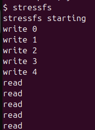

# Exploración de la Planificación de Procesos en XV6

* **Curso:** Sistemas Operativos
* **Integrantes:**
  * Santiago Torres Martínez - 202521423
  * Lissete Johana Patiño Quinayas - 202520977
* **Repositorio Fork en GitHub:** https://github.com/SantiagoTorres0/xv6-riscv

---

## 1. Preparación del Repositorio y del Entorno

### 1.1 Instrucciones Reproducibles de Configuración
Para replicar el entorno de trabajo y ejecución del sistema operativo XV6 para arquitectura RISC-V, se realizaron los siguientes pasos:

1. Se creó un *fork* del repositorio oficial `mit-pdos/xv6-riscv` en GitHub.
2. Se clonó el repositorio localmente en un directorio sin espacios en blanco en su ruta (para evitar errores con el parámetro `-ffile-prefix-map` de GCC durante la compilación):
   ```bash
   git clone https://github.com/SantiagoTorres0/xv6-riscv
   cd xv6-riscv
   ```
3. Se instalaron las herramientas de compilación cruzada para RISC-V y el emulador QEMU:
   ```bash
   sudo apt update
   sudo apt install -y git build-essential gdb-multiarch qemu-system-misc gcc-riscv64-linux-gnu binutils-riscv64-linux-gnu
   ```

### 1.2 Información del Sistema Operativo Anfitrión y Commit Base
* **Versión de Linux donde se clonó el código fuente:**
  ```text
  Linux santiago-HP-Laptop 6.17.0-22-generic #22~24.04.1-Ubuntu SMP PREEMPT_DYNAMIC Tue Mar 17 15:40:14 UTC 2 x86_64 x86_64 x86_64 GNU/Linux
  PRETTY_NAME="Ubuntu 24.04.3 LTS"
  ```
* **Identificador (hash) del commit inicial desde el cual se comenzó a trabajar:**
  ```text
  fa2ddcb7ca87a77af579380a6eafd5aff163b44f
  ```

### 1.3 Herramientas de Compilación y Ejecución
Para compilar y emular XV6 para RISC-V se utilizaron las siguientes herramientas (compilador cruzado `riscv64-linux-gnu-gcc`, enlazador `riscv64-linux-gnu-ld`, emulador `qemu-system-riscv64`, depurador `gdb-multiarch` y `make`):


---

## 2. Compilación y Ejecución de XV6

### 2.1 Evidencia de XV6 Operativo
Se compiló el código fuente del kernel y las utilidades de usuario mediante `make qemu`. Una vez iniciado el shell (`$ `), se ejecutaron los comandos `ls` y `cat README` para verificar que el sistema de archivos y la ejecución de procesos de usuario operan correctamente:

```text
xv6 kernel is booting

hart 2 starting
hart 1 starting
init: starting sh
$ cat README
xv6 is a re-implementation of Dennis Ritchie's and Ken Thompson's Unix
Version 6 (v6). xv6 loosely follows the structure and style of v6,
but is implemented for a modern RISC-V multiprocessor using ANSI C.

ACKNOWLEDGMENTS
...
$ ls
.              1 1 1024
..             1 1 1024
README         2 2 2227
cat            2 3 32864
echo           2 4 31720
forktest       2 5 15856
grep           2 6 36240
init           2 7 32216
kill           2 8 31680
ln             2 9 31504
ls             2 10 34808
mkdir          2 11 31736
rm             2 12 31720
sh             2 13 54168
stressfs       2 14 32608
usertests      2 15 178800
grind          2 16 47536
wc             2 17 33816
zombie         2 18 31176
console        3 19 0
```

* **Descripción de la evidencia:** La salida anterior muestra la secuencia completa de arranque del kernel (`xv6 kernel is booting`), la inicialización de los núcleos virtuales por defecto (`hart 1 starting` y `hart 2 starting`), el lanzamiento del proceso inicial de consola (`init: starting sh`) y la correcta lectura del archivo `README` junto con el listado de binarios ejecutables disponibles en el sistema de archivos.

### 2.2 Configuración y Ejecución con una Sola CPU Virtual
Para estudiar la selección de procesos sobre una única CPU sin modificar la configuración de hardware del equipo anfitrión, se ejecutó XV6 pasando el parámetro `CPUS=1` al comando `make` (el cual sobreescribe la variable `CPUS := 3` definida por defecto en el `Makefile`):

```bash
make clean
make qemu CPUS=1
```


* **Evidencia de una sola CPU activa:** En la imagen se observa que, al ejecutar `make qemu CPUS=1`, el kernel imprime `xv6 kernel is booting` y pasa directamente a `init: starting sh`, omitiendo los mensajes `hart 1 starting` y `hart 2 starting` que sí aparecían en el arranque estándar con 3 CPUs. Esto confirma que QEMU inicializó únicamente el *hart* 0 (una sola CPU virtual).

---

## 3. Investigación del Planificador Original de XV6

### 3.1 Algoritmo o Política de Planificación por Defecto

XV6 utiliza por defecto el algoritmo de planificación **Round Robin (RR)** sin prioridades. En esta política, todos los procesos listos para ejecutarse tienen la misma jerarquía y reciben turnos iguales de procesador (*quantum*). Cuando un proceso consume su intervalo de tiempo o debe esperar una operación, el sistema le retira la CPU y la asigna al siguiente proceso disponible de forma cíclica, evitando que una sola tarea acapare el procesador indefinidamente.

**Respaldo en el código fuente:**
Esta política se verifica directamente en la implementación del núcleo:
* En **`kernel/proc.h`**, ni `enum procstate` (línea **79**) ni `struct proc` (líneas **82–105**) definen atributos de prioridad, niveles de cola ni contadores de consumo acumulado de CPU.
* En **`kernel/proc.c`** (líneas **428–470**, `scheduler()`), el planificador recorre linealmente el arreglo global `proc[NPROC]` y selecciona el siguiente proceso en estado `RUNNABLE` sin aplicar ningún criterio de ordenamiento o peso.
* En **`kernel/start.c`** (líneas **55–66**, `timerinit()`), se habilita la extensión `Sstc` y se configura el temporizador hardware sumando un intervalo fijo de `1000000` ciclos (`w_stimecmp(r_time() + 1000000);` en la línea **65**, equivalente a ~0,1 s en QEMU, valor recargado luego en cada interrupción por `clockintr()` en `kernel/trap.c`). Cada vez que vence ese intervalo, `usertrap()` y `kerneltrap()` (**`kernel/trap.c`**, líneas **85–86** y **157–158**) invocan `yield()` (**`kernel/proc.c`**, líneas **500–508**), devolviendo el proceso activo a estado `RUNNABLE`.

**Evidencia en el comportamiento del sistema:**
Para observar el planificador bajo competencia por un único núcleo, primero se arrancó XV6 configurado con una sola CPU virtual (`make qemu CPUS=1`):


Sobre esa misma ejecución con `CPUS=1`, se ejecutó el programa concurrente **`stressfs`** (`user/stressfs.c`), el cual crea 5 procesos concurrentes mediante un bucle de `fork()` (índices `0` al `4`) donde cada proceso imprime `write <índice>`, realiza 20 escrituras en disco y finalmente imprime `read` antes de leer el archivo:



**Análisis de lo observado y alcance de la prueba:**
* **Concurrencia sin prioridades fijas en 1 CPU:** En la consola se observa que los cinco procesos ejecutan su impresión inicial de escritura (`write 0` a `write 4`) antes de que cualquiera complete sus 20 bloques de escritura y pase a la fase de lectura (`read`). Esto demuestra que ningún proceso tiene prioridad estática para monopolizar el sistema hasta terminar todo su ciclo de trabajo; a medida que un proceso cede la CPU, `scheduler()` avanza sobre `proc[NPROC]` y da paso a los demás.
* **Orden de aparición (`0` a `4` y líneas `read`):** El orden ascendente `write 0` a `write 4` responde tanto a la lógica de creación en `user/stressfs.c` (cada proceso padre hace `fork()`, rompe el bucle e imprime inmediatamente su índice `i` antes de iniciar el ciclo pesado de escrituras) como al orden secuencial en que quedan ubicados dentro de `proc[NPROC]`. En la fase posterior, las cinco líneas `read` no incluyen el índice del proceso en el código fuente original (`printf("read\n")`), por lo que no permiten distinguir el orden exacto en que cada proceso finalizó su escritura.
* **Alcance frente a expropiación por reloj vs. bloqueos por E/S:** Dado que `stressfs` realiza operaciones intensivas de disco, cada escritura invoca `sleep()` y cede la CPU voluntariamente mientras espera la interrupción del controlador VirtIO. En consecuencia, esta evidencia es **compatible** con Round Robin y demuestra la rotación efectiva de procesos sobre `CPUS=1`, pero por sí sola no aísla la expropiación pura por interrupción de temporizador (`yield()`) de las cesiones voluntarias por E/S (para observar únicamente la expropiación por *quantum* sin bloqueos de disco sería necesario un programa estrictamente intensivo en cálculo de CPU).

### 3.2 Archivo y Función de Selección del Siguiente Proceso

* **Archivo y función:** `kernel/proc.c` – función `scheduler(void)` (líneas **428–470**).
* **Explicación:** Cada núcleo de CPU ejecuta su propio bucle infinito dentro de `scheduler()`. En cada iteración habilita y deshabilita brevemente las interrupciones para evitar interbloqueos cuando todos los procesos están dormidos, y luego recorre linealmente la tabla global de procesos `proc[NPROC]` mediante un puntero `p`. Para cada entrada adquiere su cerrojo (`acquire(&p->lock)`) y evalúa si `p->state == RUNNABLE`. Al encontrar el primer proceso listo, cambia su estado a `RUNNING`, lo asigna a la estructura de la CPU actual (`c->proc = p`) y transfiere el contexto de ejecución mediante `swtch(&c->context, &p->context)`. Cuando el proceso cede o pierde la CPU y regresa a `scheduler()`, el planificador limpia `c->proc = 0`, libera el cerrojo y continúa avanzando hacia el siguiente índice del arreglo. Si recorre toda la tabla sin hallar procesos ejecutables (`found == 0`), ejecuta la instrucción RISC-V `wfi` (*Wait For Interrupt*) para suspender el núcleo hasta la próxima interrupción.

**Fragmento de código (`kernel/proc.c`, líneas 428–470):**
```c
void
scheduler(void)
{
  struct proc *p;
  struct cpu *c = mycpu();

  c->proc = 0;
  for(;;){
    // The most recent process to run may have had interrupts
    // turned off; enable them to avoid a deadlock since all
    // processes are waiting. Then turn them back off
    // to avoid a recent race between an interrupt and wfi,
    // where a process wfi'd before receiving an interrupt.
    intr_on();
    intr_off();

    int found = 0;
    for(p = proc; p < &proc[NPROC]; p++) {
      acquire(&p->lock);
      if(p->state == RUNNABLE) {
        // Switch to chosen process.  It is the process's job
        // to release its lock and then reacquire it
        // before jumping back to us.
        p->state = RUNNING;
        c->proc = p;
        swtch(&c->context, &p->context);

        // Process is done running for now.
        // It should have changed its p->state before coming back.
        c->proc = 0;
        found = 1;
      }
      release(&p->lock);
    }
    if(found == 0) {
      // nothing to run; stop running on this core until an interrupt can wake something up.
      asm volatile("wfi");
    }
  }
}
```

### 3.3 Relación con los Estados de los Procesos y Eventos de Cambio de Contexto

* **Estados de proceso (`kernel/proc.h`, línea 79 y `struct proc`, líneas 82–105):** El ciclo de vida de cada proceso se modela mediante `enum procstate { UNUSED, USED, SLEEPING, RUNNABLE, RUNNING, ZOMBIE }`, almacenado en `p->state`:
  * `UNUSED` / `USED`: Ranura libre en `proc[NPROC]` o recién reservada por `allocproc()` durante la creación (`fork()`).
  * `RUNNABLE`: El proceso está listo para ejecutarse y espera turno en la cola implícita `proc[NPROC]`.
  * `RUNNING`: El proceso tiene asignada una CPU y está ejecutando instrucciones actualmente (`c->proc == p`).
  * `SLEEPING`: El proceso está bloqueado esperando un evento o canal (`p->chan`), como una operación de disco o lectura de consola, mediante `sleep()`.
  * `ZOMBIE`: El proceso finalizó con `exit()`, pero conserva su entrada hasta que su proceso padre ejecute `wait()`.
  * Adicionalmente, `struct proc` almacena `p->lock` (exclusión mutua sobre su estado), `p->kstack` (pila de kernel independiente) y `p->context` (`struct context`, donde se guardan los registros *callee-saved* durante el cambio de contexto).

* **Eventos que ceden o recuperan la CPU (`kernel/trap.c`, `kernel/proc.c` y `kernel/swtch.S`):**
  1. **Expropiación por interrupción de temporizador:** Cuando vence el intervalo de reloj, el hardware genera una interrupción atendida en `usertrap()` (**`kernel/trap.c`**, líneas **85–86**) o `kerneltrap()` (**`kernel/trap.c`**, líneas **157–158**). Al detectar `which_dev == 2`, ambas funciones invocan `yield()`.
  2. **Transición `RUNNING` → `RUNNABLE` (`yield()`, `kernel/proc.c`, líneas 500–508):** `yield()` adquiere `p->lock`, cambia `p->state` de `RUNNING` a `RUNNABLE` y llama a `sched()`. (De forma análoga, si el proceso se bloquea por E/S, `sleep()` cambia su estado a `SLEEPING` y llama a `sched()`, volviendo luego a `RUNNABLE` cuando `wakeup()` despierta su canal).
  3. **Validación y salto al planificador (`sched()`, `kernel/proc.c`, líneas 479–497):** `sched()` verifica las invariantes del núcleo (cerrojo `p->lock` adquirido, profundidad de bloqueos `noff == 1`, estado distinto de `RUNNING` e interrupciones deshabilitadas) e invoca `swtch(&p->context, &mycpu()->context)`.
  4. **Cambio de contexto a nivel de registros (`swtch()`, `kernel/swtch.S`, líneas 1–42):** La rutina en ensamblador `swtch(old, new)` guarda los registros *callee-saved* (`ra`, `sp`, `s0`–`s11`) del proceso saliente en `p->context` y carga los de `c->context`. Al ejecutarse `ret`, la CPU retoma exactamente la instrucción siguiente a `swtch()` dentro de `scheduler()`, donde se libera `p->lock` y se selecciona el siguiente proceso `RUNNABLE`.

**Fragmentos de respaldo (`kernel/proc.h`, `kernel/proc.c` y `kernel/swtch.S`):**
```c
// kernel/proc.h (línea 79)
enum procstate { UNUSED, USED, SLEEPING, RUNNABLE, RUNNING, ZOMBIE };

// kernel/proc.c - yield() (líneas 500–508)
void
yield(void)
{
  struct proc *p = myproc();
  acquire(&p->lock);
  p->state = RUNNABLE;
  sched();
  release(&p->lock);
}

// kernel/proc.c - sched() (líneas 479–497)
void
sched(void)
{
  int intena;
  struct proc *p = myproc();

  if(!holding(&p->lock))
    panic("sched p->lock");
  if(mycpu()->noff != 1)
    panic("sched locks");
  if(p->state == RUNNING)
    panic("sched RUNNING");
  if(intr_get())
    panic("sched interruptible");

  intena = mycpu()->intena;
  swtch(&p->context, &mycpu()->context);
  mycpu()->intena = intena;
}
```

```asm
# kernel/swtch.S (líneas 1–42)
.globl swtch
swtch:
        sd ra, 0(a0)
        sd sp, 8(a0)
        sd s0, 16(a0)
        ...
        sd s11, 104(a0)

        ld ra, 0(a1)
        ld sp, 8(a1)
        ld s0, 16(a1)
        ...
        ld s11, 104(a1)

        ret
```

### 3.4 Incorporación del Planificador en la Compilación y Construcción de XV6

La construcción del kernel de XV6 está automatizada en el archivo **`Makefile`** de la raíz del proyecto, utilizando la cadena de herramientas cruzada para arquitectura RISC-V (`riscv64-linux-gnu-` o `riscv64-unknown-elf-`). A partir de las reglas definidas en dicho archivo (y verificable en la salida de consola al ejecutar `make`), el proceso transforma los archivos fuente del planificador y manejo de interrupciones (`kernel/proc.c`, `kernel/trap.c` y `kernel/swtch.S`) en código máquina enlazado dentro del binario final **`kernel/kernel`**:

1. **Declaración de objetos del kernel (`OBJS`, líneas 1–2 y 4–31):** En el `Makefile`, la variable `K=kernel` define el directorio del núcleo y la lista `OBJS` registra todos los archivos objeto que formarán parte del sistema operativo, incluyendo explícitamente `$K/proc.o` (línea 15), `$K/swtch.o` (línea 16) y `$K/trap.o` (línea 18).
2. **Compilación y ensamblado individual (`.c` y `.S` → `.o`, líneas 58–82 y 99–100):**
   * Los archivos en C (`kernel/proc.c` y `kernel/trap.c`) se compilan mediante la regla implícita de GNU Make usando `CC = $(TOOLPREFIX)gcc` (línea 58) con las banderas `CFLAGS` (líneas 66–82), entre las que destacan `-march=rv64gc`, `-ffreestanding` y `-nostdlib`, necesarias porque el kernel se ejecuta sin sistema operativo subyacente ni biblioteca estándar.
   * El archivo en ensamblador `kernel/swtch.S` se ensambla mediante la regla explícita `$K/%.o: $K/%.S` (líneas 99–100) hacia `kernel/swtch.o`.
3. **Enlazado en el binario del kernel (`$K/kernel`, líneas 59–61 y 94–97):** La regla `$K/kernel: $(OBJS) $K/kernel.ld` invoca al enlazador `LD = $(TOOLPREFIX)ld` (línea 59) junto con el script de enlazado `kernel/kernel.ld` (que define la disposición en memoria de las secciones del núcleo). De este modo, el código de `scheduler()`, `sched()`, `yield()`, `usertrap()` y `swtch()` queda empaquetado dentro del ejecutable ELF `kernel/kernel`. Adicionalmente, `OBJDUMP` (línea 61) genera el desensamblado (`kernel/kernel.asm`) y la tabla de símbolos (`kernel/kernel.sym`).
4. **Configuración de CPU y carga en QEMU (líneas 174–184):** Finalmente, el objetivo `qemu` depende de `$K/kernel` y de la imagen de disco `fs.img`, pasando `-kernel $K/kernel` y `-smp $(CPUS)` dentro de `QEMUOPTS` para arrancar el núcleo compilado en `qemu-system-riscv64`. Por defecto `CPUS` vale `3` (líneas 174–176); para este trabajo se ejecuta `make qemu CPUS=1`, que sobrescribe ese valor y hace que QEMU arranque con una sola CPU virtual, cumpliendo el requisito de la sección 2 y permitiendo observar la rotación de procesos descrita en la pregunta **3.1**.

**Fragmento de respaldo (`Makefile`, líneas 1–2, 4–18, 58–73, 94–100 y 174–184):**
```make
K=kernel
U=user

OBJS = \
  ...
  $K/main.o \
  $K/vm.o \
  $K/proc.o \
  $K/swtch.o \
  $K/trampoline.o \
  $K/trap.o \
  ...

CC = $(TOOLPREFIX)gcc
LD = $(TOOLPREFIX)ld
OBJCOPY = $(TOOLPREFIX)objcopy
OBJDUMP = $(TOOLPREFIX)objdump

CFLAGS = -Wall -Werror -Wno-unknown-attributes -O -fno-omit-frame-pointer -ggdb -gdwarf-2
CFLAGS += $(DETFLAGS)
CFLAGS += -march=rv64gc
CFLAGS += -std=gnu99
CFLAGS += -MD
CFLAGS += -mcmodel=medany
CFLAGS += -ffreestanding
CFLAGS += -fno-common -nostdlib
...

$K/kernel: $(OBJS)$K/kernel.ld
	$(LD)$(LDFLAGS) -T $K/kernel.ld -o$K/kernel $(OBJS)$(OBJDUMP) -S $K/kernel >$K/kernel.asm
	$(OBJDUMP) -t $K/kernel \vert{} sed '1,/SYMBOL TABLE/d; s/ .* / /; /^$$/d' > $K/kernel.sym

$K/\%.o:$K/%.S
	$(CC) -march=rv64gc -g$(DETFLAGS) -c -o $@ $<
...
ifndef CPUS
CPUS := 3
endif

QEMUOPTS = -machine virt -bios none -kernel $K/kernel -m 128M -smp$(CPUS) -nographic
...
qemu: check-qemu-version $K/kernel fs.img
	$(QEMU)$(QEMUOPTS)
```

---

## 4. Descripción de MLFQ y Exploración de su Incorporación en XV6

### 4.1 Descripción Inicial del Algoritmo MLFQ y Dudas Identificadas
*(Redactada antes de iniciar el diálogo socrático con la IA)*
* **Descripción inicial:** MLFQ es un planificador de procesos que queremos analizar para incorporar en el sistema operativo XV6. Se basa en varias colas de procesos organizadas por niveles de prioridad, en las que al proceso con mayor prioridad se le asigna un tiempo de ejecución (quantum). Al agotar ese tiempo de ejecución, el proceso pierde prioridad (baja a una cola inferior) y da paso al siguiente proceso. Además, cada proceso nuevo que entra al sistema lo hace con la prioridad más alta.
* **Dudas identificadas:** 
  1. ¿Cómo funciona exactamente Round Robin dentro de las colas de MLFQ?

  2. Si entran procesos nuevos o interactivos constantemente en la cola más alta, ¿en qué momento se ejecutan los procesos que ya agotaron su tiempo de ejecución y bajaron de prioridad sin haber terminado?

  3. ¿Cómo se mide en XV6 el tiempo que lleva ejecutándose un proceso y cuántas colas o qué tamaño de quantum deberíamos usar?

### 4.2 Prompt 1 Utilizado para la Interacción Socrática
```text
Actúa como tutor socrático de una pareja de estudiantes de cuarto semestre de Ingeniería de Sistemas. Conocemos C++ y hemos comenzado a explorar XV6 para RISC-V.
Queremos identificar y justificar qué se necesitaría para incorporar MLFQ a XV6. En esta entrega no vamos a implementarlo.

Nuestra descripción inicial del algoritmo, escrita antes de esta conversación:
MLFQ es un planificador de procesos que queremos analizar para incorporar en el sistema operativo XV6. Se basa en varias colas de procesos organizadas por niveles de prioridad, en las que al proceso con mayor prioridad se le asigna un tiempo de ejecución (quantum). Al agotar ese tiempo de ejecución, el proceso pierde prioridad (baja a una cola inferior) y da paso al siguiente proceso. Además, cada proceso nuevo que entra al sistema lo hace con la prioridad más alta.

Dudas identificadas:
1. ¿Cómo funciona exactamente Round Robin dentro de las colas de MLFQ?
2. Si entran procesos nuevos o interactivos constantemente en la cola más alta, ¿en qué momento se ejecutan los procesos que ya agotaron su tiempo de ejecución y bajaron de prioridad sin haber terminado?
3. ¿Cómo se mide en XV6 el tiempo que lleva ejecutándose un proceso y cuántas colas o qué tamaño de quantum deberíamos usar?

Lo que averiguamos del planificador original y de su incorporación al sistema compilado:
- Política por defecto: XV6 utiliza Round Robin (RR) sin prioridades sobre una única tabla global `proc[NPROC]` en `kernel/proc.h` (líneas 82–105), donde `enum procstate` (línea 79) define los estados `UNUSED`, `USED`, `SLEEPING`, `RUNNABLE`, `RUNNING` y `ZOMBIE`, sin campos de prioridad ni contadores de consumo de CPU.
- Selección de procesos: En `kernel/proc.c` (líneas 428–470), `scheduler(void)` ejecuta un bucle infinito recorriendo linealmente `proc[NPROC]`, adquiere `p->lock`, selecciona el siguiente proceso `RUNNABLE`, lo marca `RUNNING`, asigna `c->proc = p` y realiza el cambio de contexto mediante `swtch(&c->context, &p->context)` (`kernel/swtch.S`, líneas 8–40).
- Cesión y recuperación de CPU: En `kernel/start.c` (`timerinit()`, líneas 55–66), el temporizador hardware se configura sumando `1000000` ciclos (`w_stimecmp(r_time() + 1000000)`), recargado en cada interrupción por `clockintr()` en `kernel/trap.c`. Al vencer el intervalo (`which_dev == 2`), `usertrap()` y `kerneltrap()` (`kernel/trap.c`, líneas 85–86 y 157–158) llaman a `yield()` (`kernel/proc.c`, líneas 500–508), que pasa el proceso a `RUNNABLE` e invoca `sched()` (líneas 479–497). Para E/S o eventos, `sleep()` (líneas 561–572) lo pasa a `SLEEPING` y `wakeup()` (líneas 575–595) lo devuelve a `RUNNABLE`.
- Compilación: En el `Makefile`, `OBJS` incluye `$K/proc.o`, `$K/swtch.o` y `$K/trap.o`, que se compilan con `riscv64-linux-gnu-gcc` (`-ffreestanding -nostdlib`) y se enlazan con `ld` usando `kernel/kernel.ld` para producir el binario `kernel/kernel`, ejecutado en QEMU con `-smp $(CPUS)` (configurado en `CPUS=1`).

Reglas de interacción:
1. Formula una sola pregunta principal por turno y espera nuestra respuesta. No presentes una lista completa de cambios ni una arquitectura resuelta.
2. Empieza examinando nuestra descripción de MLFQ. Ayúdanos a detectar reglas ambiguas, ausentes o contradictorias. No sustituyas nuestra descripción por una versión terminada ni elijas silenciosamente una variante del algoritmo.
3. Pídenos que propongamos y justifiquemos las decisiones que faltan. Después, ayúdanos a comprobarlas con ejemplos pequeños de procesos y decisiones de planificación que nosotros debamos resolver.
4. Guíanos para relacionar cada regla con XV6. Antes de sugerir una modificación, pregúntanos qué comportamiento necesitamos y qué evidencia del código respalda nuestra propuesta.
5. No supongas que tienes acceso a nuestro repositorio. Pide los fragmentos necesarios y distingue lo observado de lo que todavía sea una hipótesis. No inventes archivos, funciones o comportamientos de nuestra versión.
6. No entregues código de implementación, ni escribas parches completos; enfócate únicamente en el diseño conceptual y su justificación.
```

### 4.3 Descripción Revisada y Coherente de MLFQ para XV6
* MLFQ es un planificador de procesos, el cuál tiene 3 colas de funcionamiento 0, 1 y 2, cada cola representa un nivel de prioridad de un proceso, cada proceso que entra se le asgina en la cola 2, de mayor prioridad, los procesos de la misma prioridad se ejecutan en orden de llegada, cada vez que el manager ejecuta todos los procesos de una cola pasa a la siguiente, cada proceso tiene maximo un quantum para ejecutarse, si al terminar ese quantum su ejecución no está terminada, pasa a la siguiente cola, hay un tiempo maximo S en el que todos los procesos suben a la cola de mayor prioridad, de esta forma los procesos de menor prioridad no se quedan esperando para siempre una nueva oportunidad de tener quantum para seguir con su ejecución, si un proceso libera la cpu antes de agotar el quantum (como esperar una entrada del teclado), no pierde prioridad, puede ser una puerta para procesos maliciosos que realenticen la ejecucion general de procesos en la cp, siempre se ejecuta el proceso con mayor prioridad, si esta ejecutando un proceso de una cola de menor prioridad, en cuanto dicho proceso agote su quantum, el planificador regresará a la cola de mayor prioridad.
Regla 1: Si Prioridad(A) > Prioridad(B), corre A (no corre B).
Regla 2: Si Prioridad(A) == Prioridad(B), corren en Round Robin (se turnan por orden de llegada usando el quantum asignado a esa cola).

Regla 3: Qué pasa cuando un proceso llega por primera vez ("cada proceso nuevo que entra al sistema lo hace con la prioridad más alta") 
Regla 4:
4a: Si un proceso agota su quantum (asignación de tiempo) mientras está ejecutándose, su prioridad se reduce (baja una cola).
4b: Si un proceso cede la CPU antes de agotar su quantum (por ejemplo, al esperar E/S con sleep()), mantiene su mismo nivel de prioridad. (Nota importante para su investigación más adelante: en la versión básica de MLFQ esto funciona bien, aunque abre la puerta a que un proceso malicioso haga E/S justo antes de acabar el quantum para "engañar" al planificador; eso es algo genial para dejar anotado en sus cuestiones pendientes o refinamientos).
Regla 5: después de un período de tiempo S, todos los procesos del sistema (sin importar en qué cola estén) se mueven de vuelta a la cola de mayor prioridad (la Cola 2). 

### 4.4 Propuesta de Cambios Necesarios en XV6

1. **Estructuras de datos de procesos ( `kernel/proc.h` - `struct proc` ):**
   * **Cambio propuesto:** Agregar dos campos enteros dentro de `struct proc`: `priority` (para registrar el nivel o cola actual del proceso, siendo `0` la máxima prioridad) y `ticks` (contador de *ticks* de CPU consumidos dentro de su *quantum* vigente). Opcionalmente, añadir punteros o enlaces si se manejan colas explícitas por nivel en lugar de índices circulares.
   * **Necesidad que atiende y justificación:** En la versión base de XV6 (`kernel/proc.h`, líneas 82–105), `struct proc` únicamente almacena el estado (`procstate`), su contexto y su candado (`p->lock`), sin ningún atributo que permita diferenciar jerarquías de prioridad ni medir cuánto tiempo de CPU lleva acumulado cada proceso.

2. **Inicialización y reinicio de prioridades ( `kernel/proc.c` - `allocproc()`, `userinit()`, `fork()` ):**
   * **Cambio propuesto:** Inicializar `p->priority = 0` (cola de mayor prioridad) y `p->ticks = 0` dentro de `allocproc()` cada vez que se reserva una ranura para un proceso nuevo (cubriendo tanto el proceso inicial creado por `userinit()` como los hijos generados con `fork()`). Asimismo, restablecer ambos campos a `0` al liberar la estructura en `freeproc()` y desvincular el proceso de cualquier cola al terminar en `exit()`.
   * **Necesidad que atiende y justificación:** Garantiza la Regla 1 de MLFQ (todo proceso nuevo ingresa por la cola más alta) y evita que futuros procesos que reutilicen entradas `UNUSED` de la tabla global `proc[NPROC]` hereden prioridades degradadas o *ticks* residuales.

3. **Contabilidad de tiempo y degradación de prioridad ( `kernel/trap.c` - `usertrap()`, `kernel/proc.c` - `yield()` ):**
   * **Cambio propuesto:** Ante cada interrupción del temporizador (`which_dev == 2` en `usertrap()` y `kerneltrap()` dentro de `kernel/trap.c`), incrementar `p->ticks` del proceso en ejecución y compararlo con el *quantum* asignado a su nivel actual. Si aún no alcanza el límite, continúa ejecutándose; si lo agota, se incrementa `p->priority` (bajando a la siguiente cola), se reinicia `p->ticks = 0` y se invoca `yield()` (`kernel/proc.c`) para ceder la CPU. En cambio, cuando el proceso cede voluntariamente la CPU por E/S mediante `sleep()`, se conserva intacto `p->priority` y se reinicia `p->ticks = 0`.
   * **Necesidad que atiende y justificación:** Permite aplicar las Reglas 3 y 4 del algoritmo apoyándose en los flujos ya existentes del núcleo: distingue entre un proceso intensivo en CPU que agota su *quantum* (degradado antes de `yield()`) y un proceso interactivo que se bloquea antes de tiempo (preservado en `sleep()` para mantener baja latencia al despertar con `wakeup()`).

4. **Selección por prioridad y *Priority Boost* ( `kernel/proc.c` - `scheduler()` / `clockintr()` ):**
   * **Cambio propuesto:** Modificar `scheduler()` en `kernel/proc.c` para buscar procesos `RUNNABLE` de forma jerárquica desde la cola de mayor prioridad hasta la inferior, rotando en orden FIFO/Round Robin dentro de un mismo nivel mediante colas separadas o un cursor circular por prioridad. Para el *priority boost* (Regla 5), `clockintr()` en `kernel/trap.c` lleva un contador global de *ticks* y, al cumplirse el período $S$, activa una bandera global (por ejemplo, `need_boost = 1`), delegando a `scheduler()` la tarea de adquirir cada `p->lock` de forma segura y devolver todos los procesos activos a `priority = 0` y `ticks = 0`.
   * **Necesidad que atiende y justificación:** Reemplaza el recorrido lineal plano actual de `scheduler()` sobre `proc[NPROC]`, evitando el sesgo de favorecer siempre los primeros índices del arreglo. Además, separar la señalización del *boost* (bandera en `clockintr()`) de su ejecución (`scheduler()`) evita adquirir múltiples `p->lock` dentro de una interrupción de hardware bajo `tickslock`, previniendo *deadlocks* y eliminando la inanición (*starvation*) en las colas bajas.

### 4.5 Decisiones Pendientes de Investigación o Soporte Adicional
Antes de llevar esta propuesta a una implementación definitiva en XV6, quedan abiertas las siguientes decisiones técnicas que requieren experimentación y soporte adicional[cite: 3]:

* **Valor óptimo del periodo $S$ (*Priority Boost*):** Determinar cada cuántos *ticks* o milisegundos debe ejecutarse el reinicio global de prioridades (Regla 5) para evitar la inanición de procesos intensivos en CPU sin degradar la capacidad de respuesta de las tareas interactivas.
* **Valores óptimos de *quantum* por cola:** Calibrar la duración del *time slice* (y el *allotment*) en cada nivel de prioridad (por ejemplo, 10 ms en Cola 2, 20 ms en Cola 1 y 40 ms en Cola 0) según la carga de trabajo real en XV6.
* **Prevención de abuso (*Gaming the Scheduler*):** Evitar que procesos maliciosos cedan voluntariamente la CPU justo antes de agotar su *quantum* para conservar la prioridad más alta; para ello se requiere llevar un contador acumulado de tiempo consumido dentro del nivel actual (Regla 4 refinada) en lugar de reiniciar el contador en cada cesión voluntaria.
* **Escalabilidad en entornos multiprocesador (múltiples CPUs):** Evaluar cómo adaptar el diseño cuando `CPUS > 1`, comparando entre mantener colas globales compartidas (protegidas con candados) o asignar grupos de colas independientes por cada núcleo de CPU.

### 4.6 Escenarios de Comprobación Teórica
#### Escenario 1: Diferenciación entre procesos interactivos (E/S) e intensivos en CPU

* **Reglas a comprobar:** **Regla 3** (todo proceso nuevo ingresa en la cola de mayor prioridad, Cola 2) y **Regla 4** (un proceso que agota su *quantum* baja de prioridad hacia Cola 1/Cola 0, mientras que uno que cede la CPU por E/S antes de agotarlo conserva su nivel en Cola 2)[cite: 3].
* **Procesos participantes y acciones:**
  1. **Proceso interactivo (Consola / `sh`):** Llega en $t = 0\text{ ms}$, imprime el carácter `$` para indicar que espera entrada del usuario y cede voluntariamente la CPU (pasando a estado `SLEEPING`) antes de agotar su *quantum* de 10 ms[cite: 3].
  2. **Proceso intensivo en CPU (Cálculo matemático):** Llega en $t = 1\text{ ms}$ y ejecuta un bucle de cómputo continuo que requiere **20 ms** totales de procesador sin realizar operaciones de entrada/salida[cite: 3].
* **Comportamiento esperado:**
  * Ambos procesos ingresan inicialmente en la **Cola 2** (mayor prioridad)[cite: 3].
  * En $t = 0\text{ ms}$, la consola realiza su operación de E/S y libera la CPU antes de consumir los 10 ms, por lo que conserva su ubicación en la **Cola 2**[cite: 3].
  * A partir de $t = 1\text{ ms}$, el proceso de cálculo entra a ejecutarse durante 10 ms seguidos; al agotar completamente su *quantum* en $t = 11\text{ ms}$ sin haber terminado (aún le restan 10 ms), el planificador lo degrada a la **Cola 1**[cite: 3]. Si la consola recibe entrada del usuario nuevamente, tendrá prioridad inmediata sobre el proceso de cálculo[cite: 3].

#### Escenario 2: Prevención de inanición mediante *Priority Boost*

* **Reglas a comprobar:** **Regla 1** (prioridad estricta entre colas), **Regla 2** (*Round Robin* dentro de una misma cola), **Regla 4** (degradación al agotar el *quantum*) y **Regla 5** (*Priority Boost* tras cumplirse el periodo $S$)
* **Parámetros de referencia:** 3 colas de prioridad (Cola 2 = alta con *quantum* de 10 ms; Cola 1 = media con *quantum* de 20 ms; Cola 0 = baja con *quantum* de 40 ms) y periodo de *Priority Boost* $S = 30\text{ ms}$.
* **Procesos participantes y acciones:**
  1. **Proceso A (intensivo en CPU):** Llega en $t = 0\text{ ms}$, requiere **20 ms** de CPU en total
  2. **Proceso B (corto):** Llega en $t = 1\text{ ms}$, requiere **10 ms** de CPU
  3. **Proceso C (corto):** Llega en $t = 15\text{ ms}$, requiere **10 ms** de CPU
  4. **Proceso D (corto):** Llega en $t = 29\text{ ms}$, requiere **10 ms** de CPU
* **Línea de tiempo paso a paso:**
  * **0–10 ms:** Entra **A** en la Cola 2. Consume los 10 ms de su *quantum*, le quedan 10 ms pendientes y es degradado a la **Cola 1** (Regla 4)
  * **10–20 ms:** **B** está listo en la Cola 2 (mayor prioridad que A en la Cola 1, Regla 1). Ejecuta sus 10 ms completos y termina en el ms 20
  * **20–30 ms:** **C** ya había llegado en el ms 15 a la Cola 2, por lo que tiene mayor prioridad que A. Ejecuta sus 10 ms completos y termina en el ms 30. Durante todo el intervalo de 10 ms a 30 ms (20 ms en total), **A** permaneció esperando sin CPU en la Cola 1
  * **En el ms 30 (se cumple $S = 30\text{ ms}$):** Justo en $t = 29\text{ ms}$ llegó **D** a la Cola 2. Sin el *Priority Boost*, **D** (Cola 2) volvería a desplazar a **A** (Cola 1). Sin embargo, al cumplirse $S = 30\text{ ms}$, la **Regla 5** sube a **A** nuevamente a la **Cola 2** y reinicia su tiempo consumido en ese nivel
  * **30–40 ms:** Como **A** y **D** ahora comparten la **Cola 2** con igual prioridad, se aplica *Round Robin* (Regla 2). Al haber sido promovido en el *boost*, **A** toma su turno, ejecuta sus 10 ms restantes y termina en el ms 40
  * **40–50 ms:** Finalmente corre **D** en la Cola 2 durante sus 10 ms y termina en el ms 50
* **Comportamiento esperado:** Verificar que, al alcanzarse el umbral de tiempo $S$ (contabilizado mediante los *ticks* del reloj del sistema), cualquier proceso degradado en colas inferiores es promovido a la cola de máxima prioridad y su contador de consumo en el nivel se reinicia, garantizando que los procesos intensivos en CPU avancen periódicamente sin sufrir inanición

## 5. Evidencia del Aprendizaje con IA y Conclusiones

### 5.1 Identificación de la Herramienta de IA
* **Servicio y modelo utilizado:** [Ej. Google Gemini / ChatGPT / etc., indicando versión si está disponible].

### 5.2 Fragmentos Seleccionados del Diálogo Socrático
*(Incluir de 3 a 5 intercambios significativos que muestren hipótesis, comprobaciones o correcciones)*

1. **Intercambio 1:**
   * **Pregunta de la IA:** ...
   * **Respuesta de los estudiantes:** ...
2. **Intercambio 2:**
   * **Pregunta de la IA:** ...
   * **Respuesta de los estudiantes:** ...
3. **Intercambio 3:**
   * **Pregunta de la IA:** ...
   * **Respuesta de los estudiantes:** ...

### 5.3 Conclusiones Generales y Retroalimentación de la IA
* **Conclusiones del equipo:** [Redactar conclusiones sobre las diferencias entre Round-Robin en XV6 y MLFQ, y las implicaciones arquitectónicas de incorporarlo].
* **Retroalimentación obtenida:** [Resumir la validación final de la IA sobre las conclusiones].

### 5.4 Reflexiones Individuales

* **Reflexión de Santiago Torres:**
El algoritmo MLFQ representa una evolución frente al planificador *Round Robin* simple que trae XV6 por defecto, ya que permite clasificar dinámicamente los procesos según su comportamiento sin necesidad de conocer de antemano cuánto tiempo tardarán en ejecutarse, favoreciendo la rapidez de respuesta en tareas interactivas sin bloquear por completo los trabajos largos, No obstante, su incorporación efectiva en XV6 requiere calibrar cuidadosamente parámetros críticos como la duración de los *quantums* por nivel, el periodo $S$ para el *Priority Boost* y un mecanismo de contabilidad acumulada de tiempo por nivel que impida que procesos maliciosos abusen de la conservación de prioridad al soltar voluntariamente la CPU antes de vencer su *quantum*, en cuanto a lo que aporte a este trabajo, principalmente en el tema de la puesta en marcha del sistema operativo y la parte teorica de como funciona MLFQ, siendo lissete quien más se empapo del código fuente de xv6 

* **Reflexión de [Nombre del Compañero]:**
  > [Escribir un párrafo individual indicando qué comprendió, qué aportó al trabajo y qué cuestión aún necesita estudiar].
