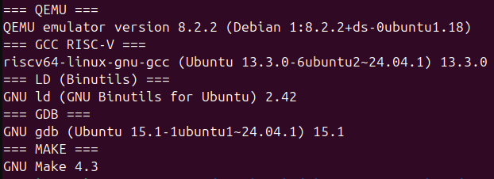
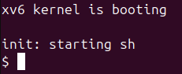

# Exploración de la Planificación de Procesos en XV6

* **Curso:** Sistemas Operativos
* **Integrantes:**
  * Santiago Torres Martínez - 202521423
  * Lissete Johana Patiño Quinayas - 202520977
* **Repositorio Fork en GitHub:** https://github.com/SantiagoTorres0/xv6-riscv

---

## 1. Preparación del Repositorio y del Entorno

### 1.1 Instrucciones Reproducibles de Configuración
Para replicar el entorno de trabajo y ejecución del sistema operativo XV6 para arquitectura RISC-V, se realizaron los siguientes pasos:

1. Se creó un *fork* del repositorio oficial `mit-pdos/xv6-riscv` en GitHub.
2. Se clonó el repositorio localmente en un directorio sin espacios en blanco en su ruta (para evitar errores con el parámetro `-ffile-prefix-map` de GCC durante la compilación):
   ```bash
   git clone https://github.com/SantiagoTorres0/xv6-riscv
   cd xv6-riscv
   ```
3. Se instalaron las herramientas de compilación cruzada para RISC-V y el emulador QEMU:
   ```bash
   sudo apt update
   sudo apt install -y git build-essential gdb-multiarch qemu-system-misc gcc-riscv64-linux-gnu binutils-riscv64-linux-gnu
   ```

### 1.2 Información del Sistema Operativo Anfitrión y Commit Base
* **Versión de Linux donde se clonó el código fuente:**
  ```text
  Linux santiago-HP-Laptop 6.17.0-22-generic #22~24.04.1-Ubuntu SMP PREEMPT_DYNAMIC Tue Mar 17 15:40:14 UTC 2 x86_64 x86_64 x86_64 GNU/Linux
  PRETTY_NAME="Ubuntu 24.04.3 LTS"
  ```
* **Identificador (hash) del commit inicial desde el cual se comenzó a trabajar:**
  ```text
  fa2ddcb7ca87a77af579380a6eafd5aff163b44f
  ```

### 1.3 Herramientas de Compilación y Ejecución
Para compilar y emular XV6 para RISC-V se utilizaron las siguientes herramientas (compilador cruzado `riscv64-linux-gnu-gcc`, enlazador `riscv64-linux-gnu-ld`, emulador `qemu-system-riscv64`, depurador `gdb-multiarch` y `make`):




---

## 2. Compilación y Ejecución de XV6

### 2.1 Evidencia de XV6 Operativo
Se compiló el código fuente del kernel y las utilidades de usuario mediante `make qemu`. Una vez iniciado el shell (`$ `), se ejecutaron los comandos `ls` y `cat README` para verificar que el sistema de archivos y la ejecución de procesos de usuario operan correctamente:

```text
xv6 kernel is booting

hart 2 starting
hart 1 starting
init: starting sh
$ cat README
xv6 is a re-implementation of Dennis Ritchie's and Ken Thompson's Unix
Version 6 (v6). xv6 loosely follows the structure and style of v6,
but is implemented for a modern RISC-V multiprocessor using ANSI C.

ACKNOWLEDGMENTS
...
$ ls
.              1 1 1024
..             1 1 1024
README         2 2 2227
cat            2 3 32864
echo           2 4 31720
forktest       2 5 15856
grep           2 6 36240
init           2 7 32216
kill           2 8 31680
ln             2 9 31504
ls             2 10 34808
mkdir          2 11 31736
rm             2 12 31720
sh             2 13 54168
stressfs       2 14 32608
usertests      2 15 178800
grind          2 16 47536
wc             2 17 33816
zombie         2 18 31176
console        3 19 0
```

* **Descripción de la evidencia:** La salida anterior muestra la secuencia completa de arranque del kernel (`xv6 kernel is booting`), la inicialización de los núcleos virtuales por defecto (`hart 1 starting` y `hart 2 starting`), el lanzamiento del proceso inicial de consola (`init: starting sh`) y la correcta lectura del archivo `README` junto con el listado de binarios ejecutables disponibles en el sistema de archivos.

### 2.2 Configuración y Ejecución con una Sola CPU Virtual
Para estudiar la selección de procesos sobre una única CPU sin modificar la configuración de hardware del equipo anfitrión, se ejecutó XV6 pasando el parámetro `CPUS=1` al comando `make` (el cual sobreescribe la variable `CPUS := 3` definida por defecto en el `Makefile`):

```bash
make clean
make qemu CPUS=1
```



* **Evidencia de una sola CPU activa:** En la imagen se observa que, al ejecutar `make qemu CPUS=1`, el kernel imprime `xv6 kernel is booting` y pasa directamente a `init: starting sh`, omitiendo los mensajes `hart 1 starting` y `hart 2 starting` que sí aparecían en el arranque estándar con 3 CPUs. Esto confirma que QEMU inicializó únicamente el *hart* 0 (una sola CPU virtual).

---

## 3. Investigación del Planificador Original de XV6

### 3.1 Algoritmo o Política de Planificación por Defecto

XV6 utiliza por defecto el algoritmo de planificación **Round Robin (RR)** sin prioridades. En esta política, todos los procesos listos para ejecutarse tienen la misma jerarquía y reciben turnos iguales de procesador (*quantum*). Cuando un proceso consume su intervalo de tiempo o debe esperar una operación, el sistema le retira la CPU y la asigna al siguiente proceso disponible de forma cíclica, evitando que una sola tarea acapare el procesador indefinidamente.

**Respaldo en el código fuente:**
Esta política se verifica directamente en la implementación del núcleo:
* En **`kernel/proc.h`**, ni `enum procstate` (línea **79**) ni `struct proc` (líneas **82–105**) definen atributos de prioridad, niveles de cola ni contadores de consumo acumulado de CPU.
* En **`kernel/proc.c`** (líneas **428–470**, `scheduler()`), el planificador recorre linealmente el arreglo global `proc[NPROC]` y selecciona el siguiente proceso en estado `RUNNABLE` sin aplicar ningún criterio de ordenamiento o peso.
* En **`kernel/start.c`** (líneas **55–66**, `timerinit()`), se habilita la extensión `Sstc` y se configura el temporizador hardware sumando un intervalo fijo de `1000000` ciclos (`w_stimecmp(r_time() + 1000000);` en la línea **65**, equivalente a ~0,1 s en QEMU, valor recargado luego en cada interrupción por `clockintr()` en `kernel/trap.c`). Cada vez que vence ese intervalo, `usertrap()` y `kerneltrap()` (**`kernel/trap.c`**, líneas **85–86** y **157–158**) invocan `yield()` (**`kernel/proc.c`**, líneas **500–508**), devolviendo el proceso activo a estado `RUNNABLE`.

**Evidencia en el comportamiento del sistema:**
Para observar el planificador bajo competencia por un único núcleo, primero se arrancó XV6 configurado con una sola CPU virtual (`make qemu CPUS=1`):


Sobre esa misma ejecución con `CPUS=1`, se ejecutó el programa concurrente **`stressfs`** (`user/stressfs.c`), el cual crea 5 procesos concurrentes mediante un bucle de `fork()` (índices `0` al `4`) donde cada proceso imprime `write <índice>`, realiza 20 escrituras en disco y finalmente imprime `read` antes de leer el archivo:


**Análisis de lo observado y alcance de la prueba:**
* **Concurrencia sin prioridades fijas en 1 CPU:** En la consola se observa que los cinco procesos ejecutan su impresión inicial de escritura (`write 0` a `write 4`) antes de que cualquiera complete sus 20 bloques de escritura y pase a la fase de lectura (`read`). Esto demuestra que ningún proceso tiene prioridad estática para monopolizar el sistema hasta terminar todo su ciclo de trabajo; a medida que un proceso cede la CPU, `scheduler()` avanza sobre `proc[NPROC]` y da paso a los demás.
* **Orden de aparición (`0` a `4` y líneas `read`):** El orden ascendente `write 0` a `write 4` responde tanto a la lógica de creación en `user/stressfs.c` (cada proceso padre hace `fork()`, rompe el bucle e imprime inmediatamente su índice `i` antes de iniciar el ciclo pesado de escrituras) como al orden secuencial en que quedan ubicados dentro de `proc[NPROC]`. En la fase posterior, las cinco líneas `read` no incluyen el índice del proceso en el código fuente original (`printf("read\n")`), por lo que no permiten distinguir el orden exacto en que cada proceso finalizó su escritura.
* **Alcance frente a expropiación por reloj vs. bloqueos por E/S:** Dado que `stressfs` realiza operaciones intensivas de disco, cada escritura invoca `sleep()` y cede la CPU voluntariamente mientras espera la interrupción del controlador VirtIO. En consecuencia, esta evidencia es **compatible** con Round Robin y demuestra la rotación efectiva de procesos sobre `CPUS=1`, pero por sí sola no aísla la expropiación pura por interrupción de temporizador (`yield()`) de las cesiones voluntarias por E/S (para observar únicamente la expropiación por *quantum* sin bloqueos de disco sería necesario un programa estrictamente intensivo en cálculo de CPU).

### 3.2 Archivo y Función de Selección del Siguiente Proceso

* **Archivo y función:** `kernel/proc.c` – función `scheduler(void)` (líneas **428–470**).
* **Explicación:** Cada núcleo de CPU ejecuta su propio bucle infinito dentro de `scheduler()`. En cada iteración habilita y deshabilita brevemente las interrupciones para evitar interbloqueos cuando todos los procesos están dormidos, y luego recorre linealmente la tabla global de procesos `proc[NPROC]` mediante un puntero `p`. Para cada entrada adquiere su cerrojo (`acquire(&p->lock)`) y evalúa si `p->state == RUNNABLE`. Al encontrar el primer proceso listo, cambia su estado a `RUNNING`, lo asigna a la estructura de la CPU actual (`c->proc = p`) y transfiere el contexto de ejecución mediante `swtch(&c->context, &p->context)`. Cuando el proceso cede o pierde la CPU y regresa a `scheduler()`, el planificador limpia `c->proc = 0`, libera el cerrojo y continúa avanzando hacia el siguiente índice del arreglo. Si recorre toda la tabla sin hallar procesos ejecutables (`found == 0`), ejecuta la instrucción RISC-V `wfi` (*Wait For Interrupt*) para suspender el núcleo hasta la próxima interrupción.

**Fragmento de código (`kernel/proc.c`, líneas 428–470):**
```c
void
scheduler(void)
{
  struct proc *p;
  struct cpu *c = mycpu();

  c->proc = 0;
  for(;;){
    // The most recent process to run may have had interrupts
    // turned off; enable them to avoid a deadlock since all
    // processes are waiting. Then turn them back off
    // to avoid a recent race between an interrupt and wfi,
    // where a process wfi'd before receiving an interrupt.
    intr_on();
    intr_off();

    int found = 0;
    for(p = proc; p < &proc[NPROC]; p++) {
      acquire(&p->lock);
      if(p->state == RUNNABLE) {
        // Switch to chosen process.  It is the process's job
        // to release its lock and then reacquire it
        // before jumping back to us.
        p->state = RUNNING;
        c->proc = p;
        swtch(&c->context, &p->context);

        // Process is done running for now.
        // It should have changed its p->state before coming back.
        c->proc = 0;
        found = 1;
      }
      release(&p->lock);
    }
    if(found == 0) {
      // nothing to run; stop running on this core until an interrupt can wake something up.
      asm volatile("wfi");
    }
  }
}
```

### 3.3 Relación con los Estados de los Procesos y Eventos de Cambio de Contexto

* **Estados de proceso (`kernel/proc.h`, línea 79 y `struct proc`, líneas 82–105):** El ciclo de vida de cada proceso se modela mediante `enum procstate { UNUSED, USED, SLEEPING, RUNNABLE, RUNNING, ZOMBIE }`, almacenado en `p->state`:
  * `UNUSED` / `USED`: Ranura libre en `proc[NPROC]` o recién reservada por `allocproc()` durante la creación (`fork()`).
  * `RUNNABLE`: El proceso está listo para ejecutarse y espera turno en la cola implícita `proc[NPROC]`.
  * `RUNNING`: El proceso tiene asignada una CPU y está ejecutando instrucciones actualmente (`c->proc == p`).
  * `SLEEPING`: El proceso está bloqueado esperando un evento o canal (`p->chan`), como una operación de disco o lectura de consola, mediante `sleep()`.
  * `ZOMBIE`: El proceso finalizó con `exit()`, pero conserva su entrada hasta que su proceso padre ejecute `wait()`.
  * Adicionalmente, `struct proc` almacena `p->lock` (exclusión mutua sobre su estado), `p->kstack` (pila de kernel independiente) y `p->context` (`struct context`, donde se guardan los registros *callee-saved* durante el cambio de contexto).

* **Eventos que ceden o recuperan la CPU (`kernel/trap.c`, `kernel/proc.c` y `kernel/swtch.S`):**
  1. **Expropiación por interrupción de temporizador:** Cuando vence el intervalo de reloj, el hardware genera una interrupción atendida en `usertrap()` (**`kernel/trap.c`**, líneas **85–86**) o `kerneltrap()` (**`kernel/trap.c`**, líneas **157–158**). Al detectar `which_dev == 2`, ambas funciones invocan `yield()`.
  2. **Transición `RUNNING` → `RUNNABLE` (`yield()`, `kernel/proc.c`, líneas 500–508):** `yield()` adquiere `p->lock`, cambia `p->state` de `RUNNING` a `RUNNABLE` y llama a `sched()`. (De forma análoga, si el proceso se bloquea por E/S, `sleep()` cambia su estado a `SLEEPING` y llama a `sched()`, volviendo luego a `RUNNABLE` cuando `wakeup()` despierta su canal).
  3. **Validación y salto al planificador (`sched()`, `kernel/proc.c`, líneas 479–497):** `sched()` verifica las invariantes del núcleo (cerrojo `p->lock` adquirido, profundidad de bloqueos `noff == 1`, estado distinto de `RUNNING` e interrupciones deshabilitadas) e invoca `swtch(&p->context, &mycpu()->context)`.
  4. **Cambio de contexto a nivel de registros (`swtch()`, `kernel/swtch.S`, líneas 1–42):** La rutina en ensamblador `swtch(old, new)` guarda los registros *callee-saved* (`ra`, `sp`, `s0`–`s11`) del proceso saliente en `p->context` y carga los de `c->context`. Al ejecutarse `ret`, la CPU retoma exactamente la instrucción siguiente a `swtch()` dentro de `scheduler()`, donde se libera `p->lock` y se selecciona el siguiente proceso `RUNNABLE`.

**Fragmentos de respaldo (`kernel/proc.h`, `kernel/proc.c` y `kernel/swtch.S`):**
```c
// kernel/proc.h (línea 79)
enum procstate { UNUSED, USED, SLEEPING, RUNNABLE, RUNNING, ZOMBIE };

// kernel/proc.c - yield() (líneas 500–508)
void
yield(void)
{
  struct proc *p = myproc();
  acquire(&p->lock);
  p->state = RUNNABLE;
  sched();
  release(&p->lock);
}

// kernel/proc.c - sched() (líneas 479–497)
void
sched(void)
{
  int intena;
  struct proc *p = myproc();

  if(!holding(&p->lock))
    panic("sched p->lock");
  if(mycpu()->noff != 1)
    panic("sched locks");
  if(p->state == RUNNING)
    panic("sched RUNNING");
  if(intr_get())
    panic("sched interruptible");

  intena = mycpu()->intena;
  swtch(&p->context, &mycpu()->context);
  mycpu()->intena = intena;
}
```

```asm
# kernel/swtch.S (líneas 1–42)
.globl swtch
swtch:
        sd ra, 0(a0)
        sd sp, 8(a0)
        sd s0, 16(a0)
        ...
        sd s11, 104(a0)

        ld ra, 0(a1)
        ld sp, 8(a1)
        ld s0, 16(a1)
        ...
        ld s11, 104(a1)

        ret
```

### 3.4 Incorporación del Planificador en la Compilación y Construcción de XV6

La construcción del kernel de XV6 está automatizada en el archivo **`Makefile`** de la raíz del proyecto, utilizando la cadena de herramientas cruzada para arquitectura RISC-V (`riscv64-linux-gnu-` o `riscv64-unknown-elf-`). A partir de las reglas definidas en dicho archivo (y verificable en la salida de consola al ejecutar `make`), el proceso transforma los archivos fuente del planificador y manejo de interrupciones (`kernel/proc.c`, `kernel/trap.c` y `kernel/swtch.S`) en código máquina enlazado dentro del binario final **`kernel/kernel`**:

1. **Declaración de objetos del kernel (`OBJS`, líneas 1–2 y 4–31):** En el `Makefile`, la variable `K=kernel` define el directorio del núcleo y la lista `OBJS` registra todos los archivos objeto que formarán parte del sistema operativo, incluyendo explícitamente `$K/proc.o` (línea 15), `$K/swtch.o` (línea 16) y `$K/trap.o` (línea 18).
2. **Compilación y ensamblado individual (`.c` y `.S` → `.o`, líneas 58–82 y 99–100):**
   * Los archivos en C (`kernel/proc.c` y `kernel/trap.c`) se compilan mediante la regla implícita de GNU Make usando `CC = $(TOOLPREFIX)gcc` (línea 58) con las banderas `CFLAGS` (líneas 66–82), entre las que destacan `-march=rv64gc`, `-ffreestanding` y `-nostdlib`, necesarias porque el kernel se ejecuta sin sistema operativo subyacente ni biblioteca estándar.
   * El archivo en ensamblador `kernel/swtch.S` se ensambla mediante la regla explícita `$K/%.o: $K/%.S` (líneas 99–100) hacia `kernel/swtch.o`.
3. **Enlazado en el binario del kernel (`$K/kernel`, líneas 59–61 y 94–97):** La regla `$K/kernel: $(OBJS) $K/kernel.ld` invoca al enlazador `LD = $(TOOLPREFIX)ld` (línea 59) junto con el script de enlazado `kernel/kernel.ld` (que define la disposición en memoria de las secciones del núcleo). De este modo, el código de `scheduler()`, `sched()`, `yield()`, `usertrap()` y `swtch()` queda empaquetado dentro del ejecutable ELF `kernel/kernel`. Adicionalmente, `OBJDUMP` (línea 61) genera el desensamblado (`kernel/kernel.asm`) y la tabla de símbolos (`kernel/kernel.sym`).
4. **Configuración de CPU y carga en QEMU (líneas 174–184):** Finalmente, el objetivo `qemu` depende de `$K/kernel` y de la imagen de disco `fs.img`, pasando `-kernel $K/kernel` y `-smp $(CPUS)` dentro de `QEMUOPTS` para arrancar el núcleo compilado en `qemu-system-riscv64`. Por defecto `CPUS` vale `3` (líneas 174–176); para este trabajo se ejecuta `make qemu CPUS=1`, que sobrescribe ese valor y hace que QEMU arranque con una sola CPU virtual, cumpliendo el requisito de la sección 2 y permitiendo observar la rotación de procesos descrita en la pregunta **3.1**.

**Fragmento de respaldo (`Makefile`, líneas 1–2, 4–18, 58–73, 94–100 y 174–184):**
```make
K=kernel
U=user

OBJS = \
  ...
  $K/main.o \
  $K/vm.o \
  $K/proc.o \
  $K/swtch.o \
  $K/trampoline.o \
  $K/trap.o \
  ...

CC = $(TOOLPREFIX)gcc
LD = $(TOOLPREFIX)ld
OBJCOPY = $(TOOLPREFIX)objcopy
OBJDUMP = $(TOOLPREFIX)objdump

CFLAGS = -Wall -Werror -Wno-unknown-attributes -O -fno-omit-frame-pointer -ggdb -gdwarf-2
CFLAGS += $(DETFLAGS)
CFLAGS += -march=rv64gc
CFLAGS += -std=gnu99
CFLAGS += -MD
CFLAGS += -mcmodel=medany
CFLAGS += -ffreestanding
CFLAGS += -fno-common -nostdlib
...

$K/kernel: $(OBJS)$K/kernel.ld
	$(LD)$(LDFLAGS) -T $K/kernel.ld -o$K/kernel $(OBJS)$(OBJDUMP) -S $K/kernel >$K/kernel.asm
	$(OBJDUMP) -t $K/kernel \vert{} sed '1,/SYMBOL TABLE/d; s/ .* / /; /^$$/d' > $K/kernel.sym

$K/\%.o:$K/%.S
	$(CC) -march=rv64gc -g$(DETFLAGS) -c -o $@ $<
...
ifndef CPUS
CPUS := 3
endif

QEMUOPTS = -machine virt -bios none -kernel $K/kernel -m 128M -smp$(CPUS) -nographic
...
qemu: check-qemu-version $K/kernel fs.img
	$(QEMU)$(QEMUOPTS)
```

---

## 4. Descripción de MLFQ y Exploración de su Incorporación en XV6

### 4.1 Descripción Inicial del Algoritmo MLFQ y Dudas Identificadas
*(Redactada antes de iniciar el diálogo socrático con la IA)*
* **Descripción inicial:** MLFQ es un planificador de procesos que queremos analizar para incorporar en el sistema operativo XV6. Se basa en varias colas de procesos organizadas por niveles de prioridad, en las que al proceso con mayor prioridad se le asigna un tiempo de ejecución (quantum). Al agotar ese tiempo de ejecución, el proceso pierde prioridad (baja a una cola inferior) y da paso al siguiente proceso. Además, cada proceso nuevo que entra al sistema lo hace con la prioridad más alta.
* **Dudas identificadas:** 
  1. ¿Cómo funciona exactamente Round Robin dentro de las colas de MLFQ?

  2. Si entran procesos nuevos o interactivos constantemente en la cola más alta, ¿en qué momento se ejecutan los procesos que ya agotaron su tiempo de ejecución y bajaron de prioridad sin haber terminado?

  3. ¿Cómo se mide en XV6 el tiempo que lleva ejecutándose un proceso y cuántas colas o qué tamaño de quantum deberíamos usar?

### 4.2 Prompt 1 Utilizado para la Interacción Socrática
```text
[Pegar aquí exactamente el Prompt 1 completo enviado a la IA, incluyendo la descripción inicial de MLFQ y la síntesis del planificador original de XV6]
```

### 4.3 Descripción Revisada y Coherente de MLFQ para XV6
* [Redactar la versión refinada del algoritmo tras la interacción socrática, definiendo la variante específica y los parámetros propuestos].

### 4.4 Propuesta de Cambios Necesarios en XV6
*(Sin código de implementación; justificando qué necesidad atiende cada cambio y qué evidencia del código lo respalda)*

1. **Estructuras de datos de procesos (`kernel/proc.h` - `struct proc`):**
   * **Cambio propuesto:** [Ej. Agregar campos para prioridad actual, ticks consumidos en el nivel actual, etc.].
   * **Necesidad que atiende y justificación:** [Explicar].
2. **Inicialización y reinicio de prioridades (`kernel/proc.c` - `allocproc()`, `userinit()`, `fork()`):**
   * **Cambio propuesto:** [Explicar].
   * **Necesidad que atiende y justificación:** [Explicar].
3. **Contabilidad de tiempo y degradación de prioridad (`kernel/trap.c` - `usertrap()`, `kernel/proc.c` - `yield()`):**
   * **Cambio propuesto:** [Explicar].
   * **Necesidad que atiende y justificación:** [Explicar].
4. **Selección por prioridad y *Priority Boost* (`kernel/proc.c` - `scheduler()` / `clockintr()`):**
   * **Cambio propuesto:** [Explicar].
   * **Necesidad que atiende y justificación:** [Explicar].

### 4.5 Decisiones Pendientes de Investigación o Soporte Adicional
* [Listar aspectos técnicos que requerirían validación experimental o investigación adicional antes de implementar, como sincronización con *spinlocks* (`p->lock`), elección óptima del periodo $S$ para evitar inanición sin degradar la interactividad, y manejo de procesos que hacen *sleep* frecuente].

### 4.6 Escenarios de Comprobación Teórica
*(Descripción conceptual sin programación ni ejecución)*

* **Escenario 1 (Regla 3 y Regla 4 - Degradación de procesos CPU-bound):**
  * **Procesos participantes:** [Describir].
  * **Acciones de los procesos:** [Describir].
  * **Regla que comprueba:** [Describir].
  * **Comportamiento esperado:** [Describir].
* **Escenario 2 (Regla 1 y Regla 2 - Prioridad de procesos interactivos I/O-bound frente a CPU-bound):**
  * **Procesos participantes:** [Describir].
  * **Acciones de los procesos:** [Describir].
  * **Regla que comprueba:** [Describir].
  * **Comportamiento esperado:** [Describir].
* **Escenario 3 (Regla 5 - *Priority Boost* y prevención de inanición):**
  * **Procesos participantes:** [Describir].
  * **Acciones de los procesos:** [Describir].
  * **Regla que comprueba:** [Describir].
  * **Comportamiento esperado:** [Describir].

---

## 5. Evidencia del Aprendizaje con IA y Conclusiones

### 5.1 Identificación de la Herramienta de IA
* **Servicio y modelo utilizado:** [Ej. Google Gemini / ChatGPT / etc., indicando versión si está disponible].

### 5.2 Fragmentos Seleccionados del Diálogo Socrático
*(Incluir de 3 a 5 intercambios significativos que muestren hipótesis, comprobaciones o correcciones)*

1. **Intercambio 1:**
   * **Pregunta de la IA:** ...
   * **Respuesta de los estudiantes:** ...
2. **Intercambio 2:**
   * **Pregunta de la IA:** ...
   * **Respuesta de los estudiantes:** ...
3. **Intercambio 3:**
   * **Pregunta de la IA:** ...
   * **Respuesta de los estudiantes:** ...

### 5.3 Conclusiones Generales y Retroalimentación de la IA
* **Conclusiones del equipo:** [Redactar conclusiones sobre las diferencias entre Round-Robin en XV6 y MLFQ, y las implicaciones arquitectónicas de incorporarlo].
* **Retroalimentación obtenida:** [Resumir la validación final de la IA sobre las conclusiones].

### 5.4 Reflexiones Individuales

* **Reflexión de Santiago [Apellido]:**
  > [Escribir un párrafo individual indicando qué comprendió, qué aportó al trabajo y qué cuestión aún necesita estudiar].

* **Reflexión de [Nombre del Compañero]:**
  > [Escribir un párrafo individual indicando qué comprendió, qué aportó al trabajo y qué cuestión aún necesita estudiar].
